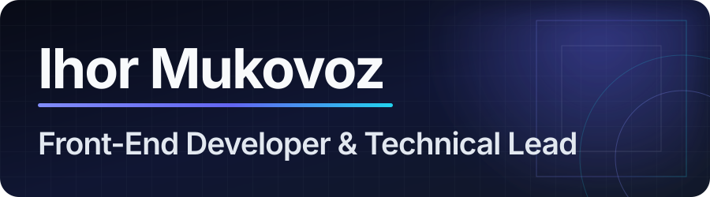

<p align="center">
  
</p>

<p align="center">
  <a href="https://themkvz.com/"></a>
  <a href="https://www.linkedin.com/in/ihor-mukovoz/"></a>
  <a href="mailto:ihor@themkvz.com"></a>
</p>

Front-End Developer building scalable web and cross-platform applications with React, Next.js, Expo, TypeScript, JavaScript, PHP, and WordPress.

I focus on clean code, practical architecture, performance, and product value. I work across engineering, design, and marketing to modernize complex systems, using AI as an assistant for repetitive work while keeping judgment and quality human-owned.

```ts
const ihor = {
  role: "Senior Full-Stack & Front-End Engineer",
  basedIn: "Ukraine",
  builds: ["product platforms", "cross-platform apps", "developer systems"],
  optimizesFor: ["clarity", "performance", "maintainability"],
  currentFocus: "modernizing complex products and cross-platform applications",
} as const;
```

## Selected impact

- **Product modernization** - rebuilding public web experiences and internal systems on a modern, scalable stack.
- **Technical leadership** - led delivery, code reviews, task planning, onboarding, and technical interviews while helping teams ship integrated customer systems.
- **Volunteer engineering** - building a cross-platform mobile app and React admin dashboard with a volunteer team.
- **Multi-market delivery** - created reusable commerce foundations and customer integrations for regional storefronts.

## Core stack

**Frontend**


**Backend & data**


**Delivery & quality**


## How I work

<table>
  <tr>
    <td width="33%" valign="top">
      <strong>Product first</strong><br />
      Architecture serves the user, the team, and the business outcome.
    </td>
    <td width="33%" valign="top">
      <strong>Simple by design</strong><br />
      Clear boundaries and boring solutions beat accidental complexity.
    </td>
    <td width="33%" valign="top">
      <strong>AI with judgment</strong><br />
      I use AI to accelerate routine work while keeping engineering decisions human-owned.
    </td>
  </tr>
</table>

## Beyond the day job

- Pursuing an MSc in **Software Engineering and Artificial Intelligence**.
- Volunteering on mobile and admin tooling for **I-Volunteer**.
- Exploring better ways to combine AI-assisted development with strong review, testing, and delivery practices.

<p align="center">
  <strong>Have a useful, difficult problem?</strong><br />
  <a href="https://themkvz.com/">Explore my work</a> ·
  <a href="https://www.linkedin.com/in/ihor-mukovoz/">Connect on LinkedIn</a> ·
  <a href="mailto:ihor@themkvz.com">Send an email</a>
</p>
